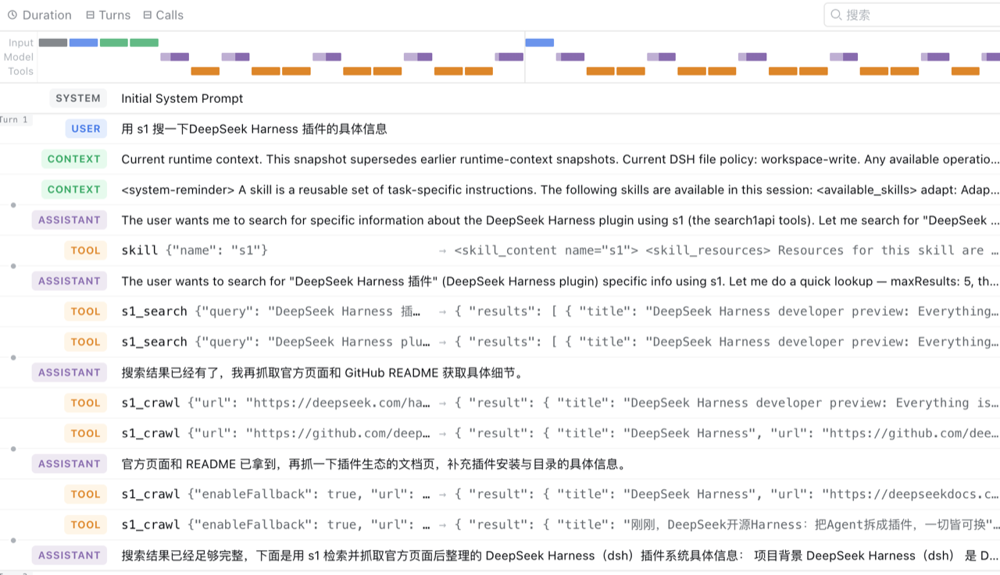

# dsh-s1

[](https://awesome-dsh-plugin.com)

Native [s1](https://s1.dev) tools for the [DeepSeek Harness](https://github.com/deepseek-ai/deepseek-harness) (DSH).

Unlike the MCP server (`search1api-mcp`, a generic bridge that surfaces as
`mcp__search1api__*`) or the CLI skill (which teaches the model to shell out to
`s1`), this package registers **first-class DSH tools** named `s1_*` — same
layer as `read`, `bash`, `subagent`, `workflow`. Calls run in-process against
the official [`@search1api/client`](https://www.npmjs.com/package/@search1api/client) SDK.

## Tools

| Tool | Backed by | Status |
|------|-----------|--------|
| `s1_search` | `Search1API.search()` | ✅ |
| `s1_news` | `Search1API.news()` | ✅ |
| `s1_crawl` | `Search1API.crawl()` | ✅ |
| `s1_sitemap` | `Search1API.sitemap()` | ✅ |
| `s1_trending` | `Search1API.trending()` | ✅ |

Not yet implemented: `s1_screenshot` (needs DSH attachment/image support) and
`s1_deepcrawl` (long-polling task).



## Skill

The package also bundles a `s1` skill (`ctx.skills.register`), which teaches the
model how to pick the right tool and tune parameters — quick lookup vs deep
research, source/recency signals, Chinese-query engine choice, and when to
follow a search result with `s1_crawl`. It is registered with the tools and can
be disabled independently via `skill: false`.

## Architecture

```
@search1api/client  (official SDK, in-process)
        │ import
dsh-s1              (Cordis plugin: name/inject/apply)
        │ loaded by the `s1-tools` row in cordis.patch.yml
ctx.tools.register(defineTool({ name: "s1_search", ... }))
        │
DSH model sees `s1_search` as a native tool
```

The package is both the **bundle** (its `dsh.bundle.patch` → `cordis.patch.yml`)
and the **plugin** (its main entry exports `name`/`inject`/`apply`). The patch
inserts a single loader row that references the package itself:

```yaml
- insert:
    - id: s1-tools
      name: 'dsh-s1'
```

## Install into a DSH profile

First publish (or `npm link` / local path) the package, then:

```sh
dsh plugin --profile web add dsh-s1
```

For a local checkout, use a path spec (the plugin command anchors relative
paths to your invoking directory):

```sh
cd /Volumes/More/Products/search1api/ecosystem/dsh-s1
npm run build                      # produce lib/index.js + lib/index.d.ts
cd ~/.dsh
dsh plugin --profile web add file:/Volumes/More/Products/search1api/ecosystem/dsh-s1
```

`dsh plugin` reconciles `dsh.profile.bundles`: because this package declares
`dsh.bundle.patch`, it is appended to the profile's bundle stack automatically.

## Authentication

The SDK reads its key lazily, so a missing key fails the tool call (not plugin
activation). There is exactly **one** credential variable:

```sh
export S1_KEY=...
```

### OAuth (roadmap — not implemented yet)

s1's API accepts `Authorization: Bearer <token>` for both an API key
and an OAuth access token, so the transport layer is token-agnostic. The OAuth
*flow* (browser login, PKCE, token storage, refresh) currently lives only in
`search1api-cli` (`s1 login` + `auth.ts`); `@search1api/client` does not yet
expose it. The DSH plugin will support OAuth by reusing or sinking that flow,
rather than re-implementing it — tracked separately from this skeleton.

## Config

| Key | Default | Description |
|-----|---------|-------------|
| `search` | `true` | Register `s1_search`. |
| `news` | `true` | Register `s1_news`. |
| `crawl` | `true` | Register `s1_crawl`. |
| `sitemap` | `true` | Register `s1_sitemap`. |
| `trending` | `true` | Register `s1_trending`. |
| `skill` | `true` | Register the bundled `s1` skill. |

## Development

```sh
npm install
npm run typecheck
npm run build
```
